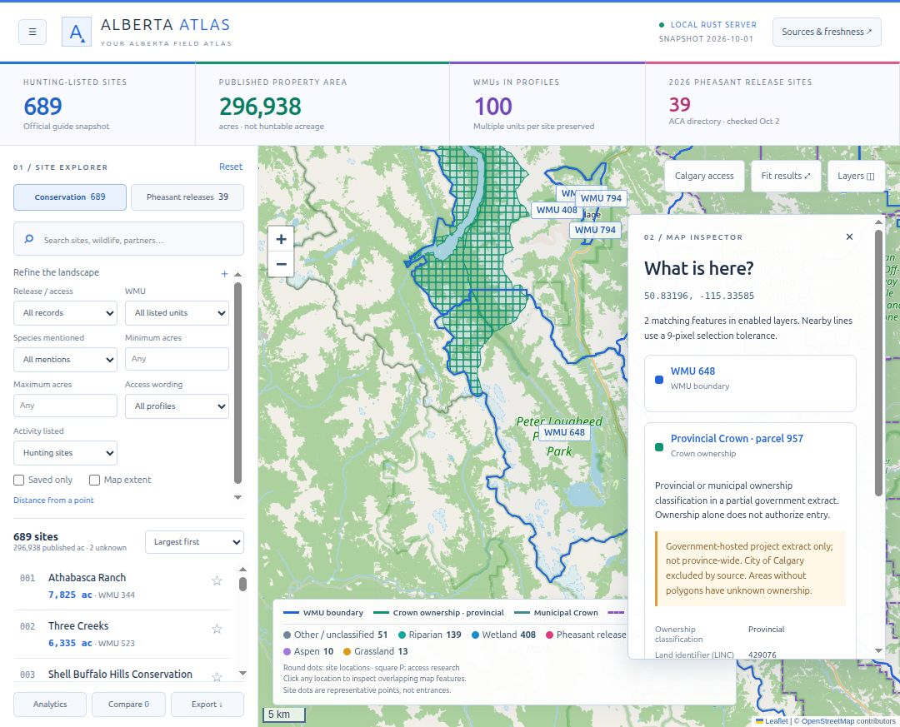
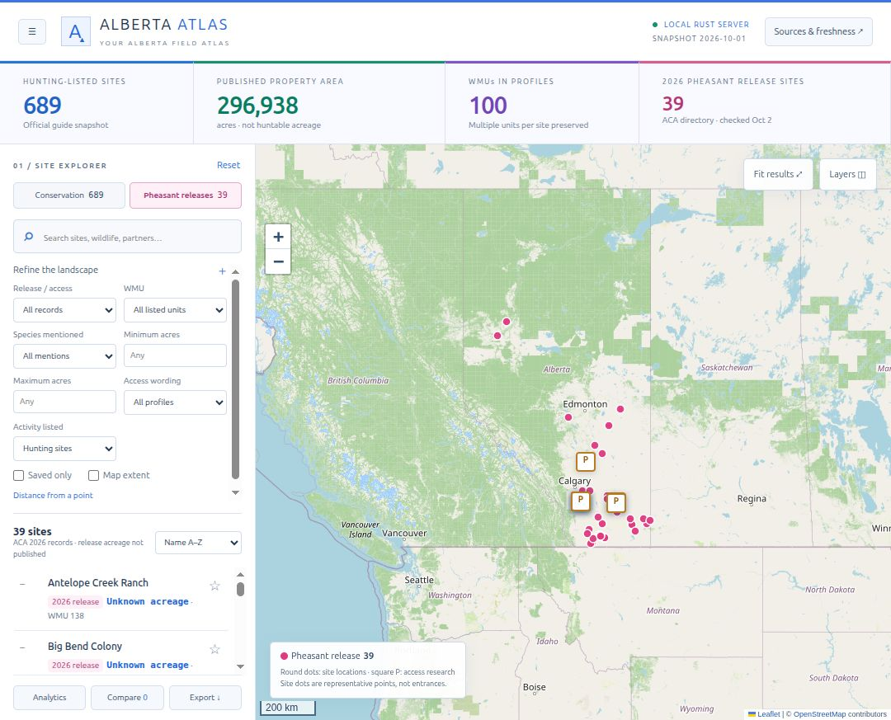
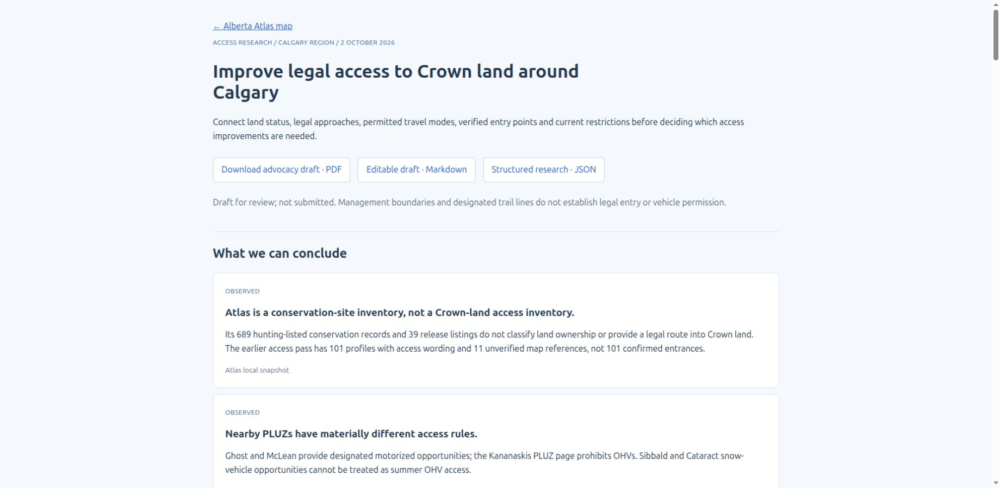

# Alberta Atlas

**Explore Alberta conservation lands, pheasant release sites, wildlife management units and Crown-land access research on one interactive map.**

Alberta Atlas brings scattered site profiles and government map layers into a searchable local workspace. Find a property, read its published details and restrictions, inspect nearby map features, and follow the original sources. Built for people researching hunting, wildlife, conservation and outdoor access in Alberta—and for contributors who want to make that research easier.

This is an independent project in active development. The current application runs on your computer; there is no public hosted demo yet. Coverage and access verification are still being improved.

*Inspect overlapping WMU and Crown features with source attributes and explicit coverage limits. Screenshot captured 2 October 2026.*

[Project status](#project-status) · [Screenshots](#screenshots) · [Sources and coverage](#sources-and-coverage) · [Contribute](CONTRIBUTING.md) · [Roadmap](ROADMAP.md)

## What you can explore

| Feature | What it helps you do |
| --- | --- |
| **689 hunting-listed conservation properties** | Search published descriptions, restrictions, habitat and wildlife mentions; filter by WMU, acreage and distance. Open the original property profile from each record. |
| **39 official 2026 pheasant release listings** | Browse annual release information, legal-quarter references and published access conditions. These are dated snapshots, not a live release schedule. |
| **WMU, PLUZ and Crown overlays** | Inspect wildlife management units, public land use zones and a partial southern Alberta Crown-classification extract. Click a location to see overlapping enabled features. |
| **Calgary-area access research** | Explore source-backed research around Ghost, McLean Creek, Kananaskis, Sibbald and Cataract, including missing information and a draft advocacy brief. |
| **Search, compare and export** | Compare up to six sites and export filtered JSON, CSV or GeoJSON. Save favourites and personal notes in your browser. |
| **Source visibility** | Review provenance, retrieval dates and limitations alongside the map. Local property records work without internet; basemap tiles and online refreshes need a connection. |

The conservation snapshot contains **296,938 published property acres**. That total is property area, not verified huntable acreage. A map boundary, Crown classification, trail line or species mention does **not** establish permission to enter, hunt or drive. Read linked official conditions and current orders before making access decisions.

## Screenshots

### Browse pheasant release sites

*Browse the 2026 release list alongside the map, narrow results, and follow linked profiles. Screenshot captured 2 October 2026.*

### Understand Calgary-area access research

*Review official sources, research findings and gaps that need better evidence. Screenshot captured 2 October 2026.*

These are screenshots of the working application, not mockups. Basemap imagery remains credited to its providers; see [third-party notices](THIRD_PARTY_NOTICES.md).

## Project status

**This public repository is the project showcase and contribution hub.** It includes real application screenshots, a feature overview and a roadmap. The working Rust/Leaflet application and full local data snapshots are not included in this public release. Cloning this repository does not install the application.

The application currently runs locally using Rust/Axum, plain JavaScript and vendored Leaflet. A runnable public release is planned after source-data redistribution terms are resolved. There is no public hosted demo yet.

## Sources and coverage

The application screenshots show the local snapshot checked on 1–2 October 2026:

- **Conservation properties:** 689 hunting-listed records from the [Alberta Discover Guide](https://www.albertadiscoverguide.com/search.cfm?h=1). Published descriptions and restrictions remain attributed to their sources. Two records have unknown acreage.
- **Pheasant releases:** all 39 listings in the [ACA 2026 release directory](https://www.ab-conservation.com/programs/wildlife/provincial-pheasant-releases/search-release-sites/). Annual listings are not live release schedules.
- **Wildlife management units:** official [Alberta WMU context](https://www.alberta.ca/wildlife-management-units); a unit boundary does not establish hunting permission.
- **Public land use zones:** official [Alberta PLUZ information](https://www.alberta.ca/public-land-use-zones), with Calgary-area access research covering Ghost, McLean Creek, Kananaskis, Sibbald and Cataract.
- **Crown classification:** a partial southern project extract from a government-hosted service. It excludes the City of Calgary and is not provincewide or proof of current title. Blank map areas mean unknown ownership.

Property representative points are bounding-box midpoints, not verified entrances. The local research includes 11 explicitly unverified mapped access references for three properties; these do not establish legal entry. Published wildlife mentions are not population estimates or guaranteed sightings.

Check original site profiles and current official restrictions before planning a visit. See [third-party notices](THIRD_PARTY_NOTICES.md) for attribution and public-release scope.

## Help improve Alberta Atlas

Useful contributions include clearer site descriptions, documented access corrections, photos with permission and accurate location context, accessibility improvements, and map performance fixes. [CONTRIBUTING.md](CONTRIBUTING.md) explains the evidence and photo details to include. [ROADMAP.md](ROADMAP.md) lists current priorities.

If this project is useful, star the repository to follow its progress, and share a specific issue or improvement. We are building toward easier discovery, more understandable profiles and better verified access information.

Dataset and third-party content retain their source rights. An open-source licence has not yet been assigned; no blanket reuse permission is asserted over third-party material.
